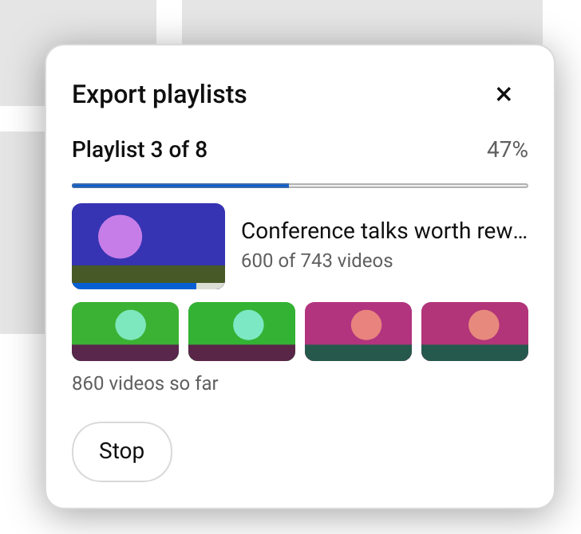
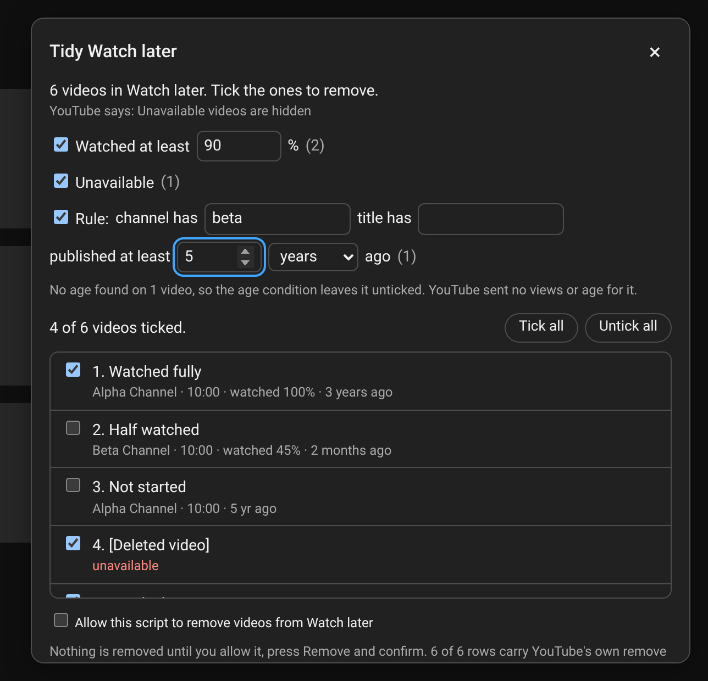
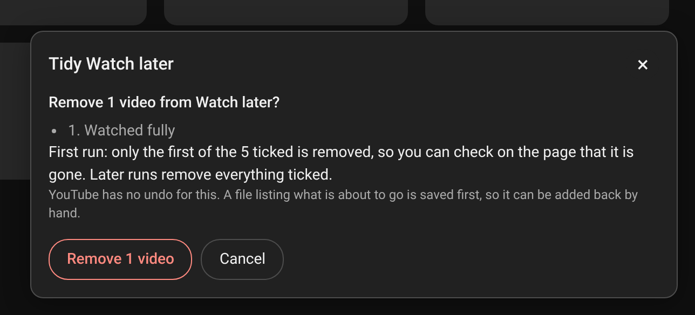

# YouTube Playlists Export

A userscript (and bookmarklet) that exports your YouTube playlists and watch history as JSON and CSV, and helps you tidy up Watch later.

It runs in your own signed-in browser tab and talks only to youtube.com. No API key, no account linking, no server.

> **Unofficial.** This uses the same internal web API the YouTube page itself uses. YouTube changes that API without notice, so parts of this can stop working at any time. See [When YouTube changes](#when-youtube-changes).

## What it does

| Page | Button | Result |
| --- | --- | --- |
| `youtube.com/feed/playlists` | **Export playlists** | Every playlist, optionally with every video in it, as JSON and CSV |
| `youtube.com/feed/history` | **Export history** | Your watch history for the last 7 days, 30 days, or everything, as JSON and CSV |
| `youtube.com/playlist?list=WL` | **Tidy Watch later** | A tick list of your Watch later videos, with filters, and an opt-in step to remove the ticked ones |

| Export in progress | Watch later tick list | Confirming a removal |
| --- | --- | --- |
|  |  |  |

Screenshots come from the automated tests, which run against mock data.

## Install

### As a userscript (recommended)

1. Install a userscript manager such as [Violentmonkey](https://violentmonkey.github.io/) or [Tampermonkey](https://www.tampermonkey.net/).
2. Open [`youtube-playlists-export.user.js`](https://raw.githubusercontent.com/ShaneIsley/yt-lists/main/youtube-playlists-export.user.js). The manager offers to install it, and will pick up later versions from the same address.
3. Go to one of the pages in the table above. The button appears in the bottom right corner.

The script matches all of `youtube.com` because YouTube is a single-page app: it has to be present already when you navigate to one of those pages. It shows its button only on the three pages above and does nothing elsewhere.

### As a bookmarklet

1. Create a bookmark and paste the whole content of [`youtube-playlists-export.bookmarklet.txt`](youtube-playlists-export.bookmarklet.txt) as its address.
2. Open YouTube, go to the page you want, and click the bookmark.

The bookmarklet is the same code, minified. It opens the panel straight away: for the history on the history page, for Watch later on the Watch later page, and for playlists anywhere else.

## Use

### Export playlists

Choose **Playlists only** (title, link and video count of each playlist) or **Playlists and their videos**. The second reads every playlist, 100 videos per request, and takes longer.

While it runs you see overall progress, the playlist being read with its own progress, and an estimate of the time left. **Stop** keeps what was read so far, and the files say they are incomplete. Closing the panel does not stop the export; it carries on behind the button.

When it finishes, download the JSON, the CSV, or both. Playlists that could not be read, or that gave fewer videos than YouTube counts, are listed.

### Export history

Choose **Last 7 days**, **Last 30 days** or **Everything**, and whether to include Shorts.

YouTube groups the history by day and gives no time of day, so each item gets a date (`watchedOn`) and YouTube's own heading for it (`watchedOnText`). "Everything" goes as far back as YouTube keeps it and can take a long time; **Stop** keeps what was read.

### Tidy Watch later

Press **Read the list**. Reading changes nothing. You then get every video in Watch later with a tick box, and three filters that tick for you:

- **Watched at least N%** (default 90).
- **Unavailable**: rows YouTube marks as not playable.
- **Rule**: channel contains, title contains, published at least N years or months ago. Every condition you fill in must hold.

Ticks you set by hand survive filter changes. **Tick all** and **Untick all** are above the list. **Save ticked as JSON/CSV** saves the selection without changing anything.

#### Removing videos

Removal is off until you tick **Allow this script to remove videos from Watch later**. Your browser remembers that choice.

1. Tick videos and press **Remove N ticked…**.
2. A question shows how many will go and names the first few. Nothing has been sent yet.
3. On confirming, a file listing what is about to go is saved (`youtube-watch-later-removed-<date>.json`), and then the videos are removed one at a time.

Safeguards:

- **First run removes one video.** Until one removal has worked in your browser, a run removes only the first ticked video, so you can check on the page that it is gone.
- **Only YouTube's own command.** Each request is built from the "Remove from Watch later" command the row itself carries. A row whose command is not exactly that is skipped and counted in the question.
- **Stops at the first problem.** After an unexpected answer or an error, nothing more is sent, and the panel says where it stopped.
- **No undo on YouTube's side.** The saved file is your record for adding videos back by hand.

After a run, press **Read the list again** before removing more, because positions in the list have shifted.

## What is in the files

All JSON files carry a `schema` name and the time they were made. CSV files hold the same rows, UTF-8 with a byte-order mark so that spreadsheets open them correctly.

**Playlists** (`youtube-playlists-<date>.json`, schema `youtube-playlists-export/1`)

- Per playlist: `id`, `title`, `url`, `type`, `videoCount`, `owner`, `details`.
- Per video: `position`, `videoId`, `title`, `channel`, `channelId`, `duration`, `durationSeconds`, `viewsText`, `publishedText`, `youtubeIndex`, `watchedPercent`, `resumeSeconds`, `url`.

**History** (`youtube-history-<date>.json`, schema `youtube-history-export/1`)

- Per item: `position`, `watchedOn`, `watchedOnText`, `kind` (`video` or `short`), then the video fields above.
- The file also says which range was asked for, whether Shorts are included, and whether the export was complete or stopped.

**Watch later selection** (`youtube-watch-later-ticked-<date>.json`, schema `youtube-watch-later-ticked/1`) and **removal record** (`youtube-watch-later-removed-<date>.json`, schema `youtube-watch-later-removal/1`)

- Per video: the video fields above, plus `playable` and `setVideoId` (the entry's own id in the playlist).

Things to know about the values:

- `viewsText` and `publishedText` are what YouTube shows: rounded, relative, and in your YouTube language ("1.2M views", "3 years ago"). They are not exact counts or dates.
- `watchedPercent` is how far your account has watched the video, or `null` if it was never started.
- Thumbnails are shown in the panel while it works, but are not written to the files.

## Privacy and safety

- Requests go only to `youtube.com`, signed with your session's cookies the way the page signs its own requests. Nothing is sent anywhere else.
- The script runs with `@grant none`: it asks the userscript manager for no extra permissions.
- Exports only read. The only requests that change anything are the Watch later removals, which you have to allow and confirm.
- The script stores two small settings in the page's `localStorage`: whether removal is allowed, and whether a removal has worked once.
- Requests are paced (250 ms apart by default). If YouTube asks it to slow down, it waits and retries a few times, then stops.

## Limits

- **Hidden videos.** YouTube hides unavailable videos from playlists behind a notice. Those are not read, so a playlist can give fewer videos than YouTube counts, and the Watch later "Unavailable" filter only catches rows YouTube still sends.
- **No watch times.** The history has dates only.
- **Ages in other languages.** The Watch later age rule reads English directly and other languages through the browser's own wording. If an age cannot be read, the panel says how many videos that affects and quotes an example.
- **Your own account only.** It reads what the signed-in page can see.

## Settings

The `CONFIG` object at the top of the script holds the settings. The ones most likely to matter:

| Setting | Default | Meaning |
| --- | --- | --- |
| `requestDelayMs` | `250` | Pause between requests |
| `maxRetries` | `3` | Retries after "too many requests" or a server error |
| `pictures` | `true` | Show thumbnails in the progress view; `false` makes no image requests |
| `recentPictures` | `4` | Thumbnails in the strip under the progress bar |
| `videoPicture` | `'default'` | Thumbnail size (120×90); `'mqdefault'` is sharper and larger |

Edits to the installed copy are lost when the script updates.

## When YouTube changes

Everything that depends on the shape of YouTube's data is in one section of the script, "YouTube data shapes". Two console scripts report that shape, so a change can be found without guessing:

- [`youtube-browse-probe.console.js`](youtube-browse-probe.console.js): playlists, and Watch later with `const PLAYLIST = 'WL';`
- [`youtube-history-probe.console.js`](youtube-history-probe.console.js): the watch history

Paste one into the DevTools console on the matching page while signed in. It only reads. It checks that each thing the exporter relies on is still where it looks, lists the field names and types it found, and shows what changed since the last run in that browser. The report holds no titles, ids or tokens (the history probe does include the day headings), so it can be attached to [an issue](https://github.com/ShaneIsley/yt-lists/issues): `copy(ytProbe)` or `copy(ytHistoryProbe)` puts it on the clipboard.

## Development

```
youtube-playlists-export.user.js         the source
youtube-playlists-export.bookmarklet.txt built from the source
build.mjs                                builds the bookmarklet
test/run.mjs                             scripted scenarios in jsdom, against a mock API
test/browser.mjs                         the same script in headless Chrome
test/fixtures.mjs                        mock YouTube responses
shots/                                   screenshots written by test/browser.mjs
```

```sh
npm install
npm run build          # userscript -> bookmarklet
npm test               # build, then the jsdom scenarios (about two minutes)
npm run test:browser   # build, then headless Chrome; set CHROME to your Chrome binary
```

The bookmarklet is generated; edit only the userscript. Keep `@name` and `@namespace` unchanged so that updates install over the existing copy, and raise `@version` with every change: userscript managers update from `@updateURL` only when the version there is higher.

The tests run against mock data shaped like real responses. They cannot tell you that YouTube still answers that way; the probes do that.

## Status

Used in Firefox with a userscript manager for the playlists export and for Watch later, including removal. The history export is built from the observed shape of the history page and is covered by the tests, with less live use so far. Reports from other browsers are welcome.
